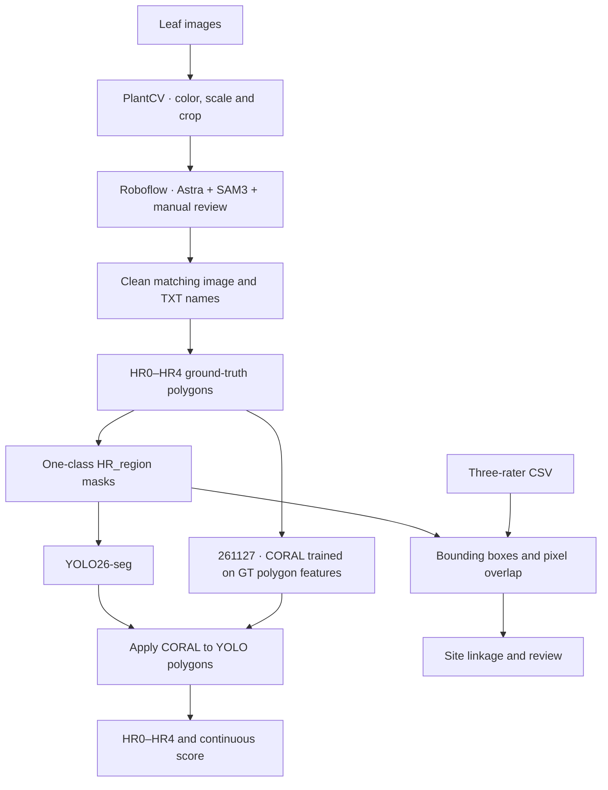

# Automated Quantification of Plant Hypersensitive Response

## Project Overview

Quantify visible hypersensitive response (HR) in *Nicotiana benthamiana* leaf images using PlantCV, vision-language-assisted annotation, YOLO26 segmentation and CORAL ordinal regression. Outputs include a region mask, a grade from HR0 to HR4 and an expected HR score on a 0–4 scale.

**한국어 요약**

PlantCV로 잎 사진을 보정하고 Roboflow에서 SAM3와 Astra가 보조한 Polygon을 검수합니다. YOLO26-seg로 침윤 부위를 검출하고, 11월 27일 CORAL 모델로 HR 등급과 연속 점수를 추정합니다. 3인 평가 CSV와 ROI는 별도의 매핑·검수 작업입니다.

## Scientific Background

Plant hypersensitive response can involve localized cell death. Visible chlorosis and necrosis support a five-grade rubric covering healthy green tissue through dry necrosis and tissue collapse. [Tobacco hypersensitive cell death](https://www.plantphysiol.org/content/plantphysiol/138/3/1516.full.pdf) · [HR rubric](02_annotation/hr_grade_definitions.md)

## Experimental Workflow



## PlantCV Preprocessing

The source records a nominal 0.1 mm/px target and prints results for the leaf_on_white crop. The [preprocessing runner](01_preprocessing/README.md) retains the original algorithms and configurable paths.

## VLM-assisted Polygon Annotation

The [annotation stage](02_annotation/README.md) records the researcher-reported Roboflow workflow and captures the export-name cleanup. The [five grade definitions](02_annotation/hr_grade_definitions.md) are preserved verbatim.

## YOLO26-seg Model

[YOLO26n-seg](03_yolo_segmentation/README.md) localizes one class, HR_region. This includes healthy HR0 infiltration sites. The checkpoint's logged train/validation/test cohort was the cropped dataset.

## Expert Rater Annotation and ROI Mapping

The [ROI audit](04_roi_label_mapping/README.md) reuses infiltration bounding boxes, actual mask overlap and median-grade linkage from 261124sam3.ipynb. Sites and polygons with uncertain assignments are retained for review.

## CORAL Ordinal Regression

The [261127 implementation](05_coral_ordinal/README.md) uses Roboflow GT polygons and a 32-feature mask representation. It applies the same extractor to YOLO prediction masks. The score sums four ordered exceedance probabilities.

## Experimental Results

| Evaluation | Result |
|---|---|
| One-class YOLO, Crop Test, 8 images and 49 polygons | Mask mAP50 0.8941203, Mask mAP50–95 0.7555295 |
| 261127 CORAL, Roboflow GT validation, 48 polygons | Accuracy 77.08%, grade MAE 0.2292, QWK 0.9530 |
| Rater/ROI mapping | 86 images, 516 site rows, 514 consensus grades |

See [YOLO](results/yolo_metrics.md), [CORAL](results/coral_metrics.md), and the [ROI audit counts](results/roi_mapping_aggregate.json).

## Reproducibility

The [methodology](docs/methodology.md) identifies source notebooks and cell ranges. See the [environment and artifact guide](docs/reproducibility.md), [experimental protocol](docs/experimental_protocol.md) and [validation report](docs/validation.md).

## Installation and Usage

Install an appropriate PyTorch/TorchVision build, then run `python -m pip install -r requirements.txt`. For PlantCV, use a separate environment with the dependency versions in the [stage README](01_preprocessing/README.md). Run these examples from the repository root:

```sh
python 02_annotation/clean_roboflow_names.py private_data/roboflow_export
python 03_yolo_segmentation/evaluate_yolo26.py --dataset private_data/crop_dataset --weights private_data/yolo_best.pt --output private_data/test_recheck
python 04_roi_label_mapping/validate_labels.py --dataset private_data/crop_dataset --ratings private_data/ratings.csv
python 05_coral_ordinal/train_coral_gt.py --dataset private_data/five_class --output private_data/coral_run
python 05_coral_ordinal/evaluate_coral.py private_data/features_valid_gt.csv --checkpoint private_data/coral_gt_best.pt
python -m pytest -q
```

Training is opt-in. The original notebooks, source data and checkpoints are private local artifacts.

## Limitations

The exact Roboflow prompts and per-image color-scale lineage remain unavailable. The available test is small, and split checks operate on names and exact bytes. The 261127 experiment documents GT validation and separate YOLO inference. Integrated five-class instance-mask mAP remains unevaluated.

## References

- [PlantCV color correction](https://docs.plantcv.org/en/v4.11/transform_correct_color/)
- [Ultralytics YOLO26](https://docs.ultralytics.com/models/yolo26)
- [Cao, Mirjalili and Raschka, Rank-consistent ordinal regression](https://arxiv.org/abs/1901.07884)
