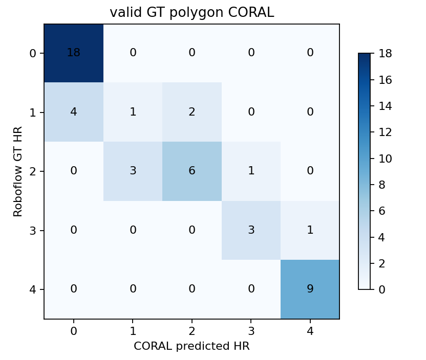

# Roboflow GT CORAL results

The source of this run is 261127coral.ipynb and the archived GT CORAL result directory. The model trained on 391 GT polygons (grade counts 174/49/45/42/81). The five-class label files contain 392 train polygons because the extractor removes masks smaller than 20 pixels.

| Evaluation | N | Accuracy | Grade MAE | Expected score MAE | QWK |
|---|---:|---:|---:|---:|---:|
| GT validation polygons | 48 | 0.7708 | 0.2292 | 0.2546 | 0.9530 |

The [aggregate report](A_aggregate.json) includes classwise metrics, true-row/predicted-column counts and mean expected HR. Results are archived for model evaluation on GT and for separate inference over YOLO validation polygons. Independent GT CORAL testing and integrated five-class instance-mask AP are unevaluated in the 261127 experiment.

